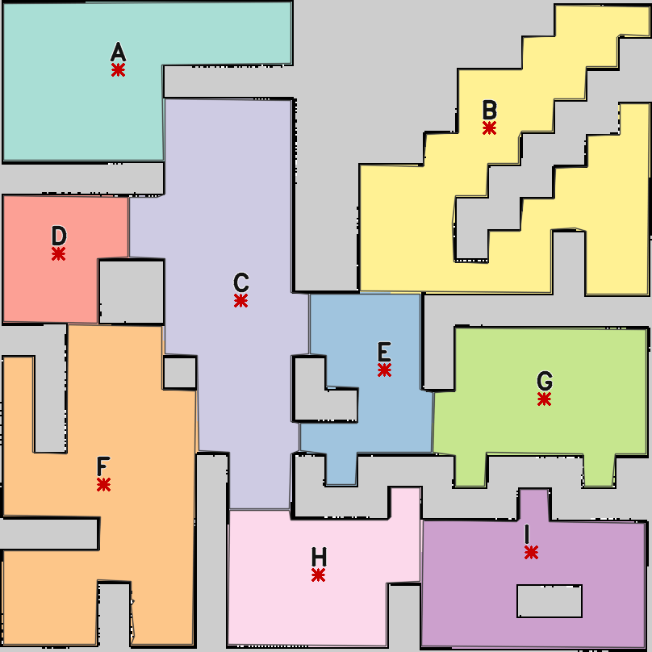

# Bài thực hành 07 – Phân vùng bản đồ và điều hướng TurtleBot 4 bằng giọng nói

ROS 2 Humble · TurtleBot 4 (Ignition Gazebo) · Nav2 · OpenCV/scikit-image · Vosk (tiếng Việt, offline)

Robot nhận lệnh nói tiếng Việt kiểu *"Đi đến khu vực A"*, *"Di chuyển từ khu vực A đến khu vực B"*,
*"Đi đến phòng thí nghiệm"*, *"Đi từ phòng học qua hành lang rồi đến thư viện"*. Nó tìm khu vực trên bản đồ
đã phân vùng rồi tự điều hướng tới đó bằng Nav2, có tránh vật cản.

```
micro / file audio ──► speech_node (Vosk + grammar) ──/voice/text──► voice_nav_node ──NavigateToPose──► Nav2
                                                                       │  CommandParser (từ / qua / đến / dừng)
                         maps/zones.yaml ◄── segment_map (offline)     ├─► /voice_nav/status   phản hồi
                                                                       ├─► /voice_nav/zone_map, /voice_nav/zones  (RViz)
                                                                       └─► /voice_nav/planned_route  đường dự kiến
```

## Nội dung nộp

| Yêu cầu | File |
|---|---|
| Bản đồ gốc | [`src/tb4_voice/maps/map.pgm`](src/tb4_voice/maps/map.pgm), [`map.yaml`](src/tb4_voice/maps/map.yaml) |
| Bản đồ phân vùng | [`src/tb4_voice/maps/map_segmented.png`](src/tb4_voice/maps/map_segmented.png), [`zone_labels.png`](src/tb4_voice/maps/zone_labels.png) (pixel = ID khu vực) |
| Thông tin khu vực | [`src/tb4_voice/maps/zones.yaml`](src/tb4_voice/maps/zones.yaml) / [`zones.json`](src/tb4_voice/maps/zones.json) |
| Nhãn ngữ nghĩa (đầu vào) | [`src/tb4_voice/config/zone_semantics.yaml`](src/tb4_voice/config/zone_semantics.yaml) |



| | Khu vực | Tâm (m) | Điểm đích Nav2 (m) | Diện tích |
|---|---|---|---|---|
| A | Phòng học | (-6.43, 7.92) | (-6.42, 7.93) | 32.3 m² |
| B | Phòng kho | (5.99, 4.61) | (5.08, 6.13) | 46.3 m² |
| C | Hành lang | (-2.91, 1.36) | (-2.62, 0.78) | 47.0 m² |
| D | Văn phòng | (-8.26, 2.20) | (-8.27, 2.23) | 13.5 m² |
| E | Sảnh chính (dock) | (1.37, -1.64) | (1.83, -1.38) | 16.9 m² |
| F | Thư viện | (-6.88, -5.17) | (-6.88, -4.92) | 46.7 m² |
| G | Phòng thí nghiệm | (6.77, -2.25) | (6.78, -2.27) | 26.7 m² |
| H | Căng tin | (-0.21, -7.72) | (-0.22, -7.72) | 23.0 m² |
| I | Phòng y tế | (6.39, -7.90) | (6.38, -7.02) | 26.1 m² |

## Cài đặt

```bash
sudo apt install ros-humble-turtlebot4-simulator ros-humble-nav2-bringup ffmpeg alsa-utils
pip install --user vosk scikit-image "numpy<2"        # gTTS chỉ cần khi tạo lại audio mẫu
# Mô hình tiếng Việt (~32 MB nén)
mkdir -p ~/.cache/vosk && cd ~/.cache/vosk
curl -LO https://alphacephei.com/vosk/models/vosk-model-small-vn-0.4.zip && python3 -m zipfile -e vosk-model-small-vn-0.4.zip .

cd ~/tb4_voice_ws && source /opt/ros/humble/setup.bash
colcon build --symlink-install && source install/setup.bash
```

## Chạy

```bash
# Terminal 1 - Gazebo + AMCL + Nav2 + RViz (gui:=false để Gazebo chạy nhanh hơn)
ros2 launch tb4_voice voice_sim.launch.py
# Đợi log "lifecycle_manager_navigation: Managed nodes are active"

# Terminal 2 - nhận dạng giọng nói (micro) + điều hướng
ros2 launch tb4_voice voice_nav.launch.py
#   source:=files            phát lần lượt test_audio/demo_*.mp3 (kịch bản video demo, chờ robot xong mới phát lệnh sau)
#   speech:=false            không dùng micro, gõ lệnh:
ros2 topic pub --once -w 1 /voice/text std_msgs/String "data: 'đi đến phòng thí nghiệm'"
ros2 topic pub --once -w 1 /voice/wav  std_msgs/String "data: '/duong/dan/lenh.wav'"   # nhận dạng 1 file

# Theo dõi phản hồi
ros2 topic echo /voice_nav/status
ros2 topic echo /voice/raw        # mọi câu Vosk nghe được + độ tin cậy
```

Cách nói được hiểu (có dấu hoặc không dấu đều được):

| Câu lệnh | Lộ trình |
|---|---|
| đi đến / tới / về **khu vực A**, **phòng B**, **vùng xê** | → A / B / C |
| đi đến **phòng thí nghiệm**, **hành lang**, **thư viện** … | → G / C / F |
| di chuyển **từ** khu vực A **đến** khu vực B | robot ở chỗ khác: → A → B; đã ở A: → B |
| đi từ phòng A **qua** hành lang C **rồi đến** B | → A → C → B (nhiều điểm đến) |
| đi đến nhà bếp / khu vực ích | báo *"Không tìm thấy khu vực …"*, robot đứng yên |
| dừng lại / hủy | hủy goal đang chạy |

Chữ cái đọc theo tiếng Việt: a, bê, xê, đê, e, ép, gờ, hát, i.

## Phân vùng lại bản đồ

```bash
ros2 run tb4_voice segment_map --map src/tb4_voice/maps/map.yaml \
    --semantics src/tb4_voice/config/zone_semantics.yaml --out src/tb4_voice/maps
```

Pipeline gồm: threshold + morphology → distance transform → lấy các lõi `dt > core_dist` làm marker →
watershed (mask = vùng trống) → gộp các vùng có cửa rộng hoặc diện tích nhỏ → chọn điểm đích gần tâm, đủ thông
thoáng, đi tới được và tránh các vật thể trong world. Tên khu vực được gán theo seed trong `zone_semantics.yaml`.

## Kiểm thử

```bash
cd src/tb4_voice
python3 -m pytest -p no:anyio test/          # 35 test: parser, tra cứu khu vực, phân vùng tái lập được
python3 tools/eval_asr.py                        # Vosk tự do vs grammar, sạch / SNR 30 / 20 dB
```

| Điều kiện | Vosk tự do | Vosk + grammar |
|---|---|---|
| Sạch | WER 38.7 %, 7/16 lệnh đúng | **WER 3.2 %, 14/16** |
| Nhiễu SNR 30 dB | 3/16 | 7/16 |
| Nhiễu SNR 20 dB | 0/16 | 2/16 |

Để đánh giá bằng giọng thật, ghi file `arecord -f S16_LE -r 16000 -c 1 x.wav` vào `test_audio/` và thêm dòng
`x.wav<TAB>câu lệnh` vào `test_audio/transcripts.tsv`.

## Cấu trúc

```
src/tb4_voice/
├── tb4_voice/
│   ├── map_segmentation.py   # OpenCV/skimage: free mask, distance transform, watershed, gộp vùng, điểm đích
│   ├── segment_map.py        # CLI -> zones.yaml/json, zone_labels.png, map_segmented.png
│   ├── zones.py              # nạp zones.yaml, tra cứu (x, y) -> khu vực
│   ├── command_parser.py     # câu tiếng Việt -> intent + lộ trình; sinh grammar cho Vosk
│   ├── speech.py             # Vosk + micro (arecord) / file (ffmpeg)
│   ├── speech_node.py        # ROS 2: audio -> /voice/text
│   └── voice_nav_node.py     # ROS 2: /voice/text -> Nav2 NavigateToPose, undock, RViz markers
├── launch/voice_sim.launch.py, voice_nav.launch.py
├── config/zone_semantics.yaml, voice_nav.yaml, voice_nav.rviz
├── maps/  worlds/  test_audio/  test/
└── tools/eval_asr.py, record_run.py, make_figures.py
```

Launch mô phỏng dùng lại bản sửa lỗi lidar (overlay `ogre2` cho Create 3) và cơ chế tự đặt initial pose cho
AMCL từ bài 05.
